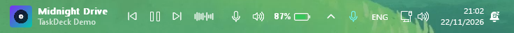
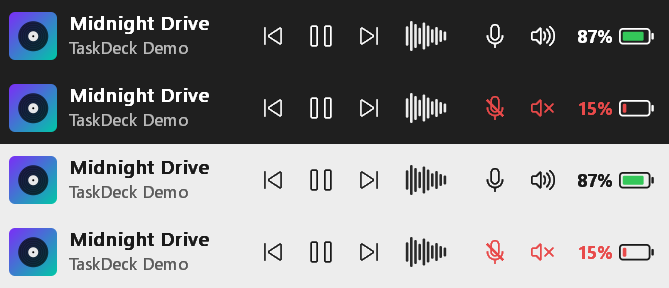
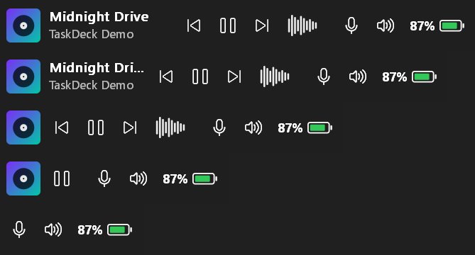

# TaskDeck

A small, fast Windows 11 widget written in Rust that lives **inside the taskbar**, just left of the system tray, on every monitor.


- **Mic and speaker mute**: one click. It works directly with **Voicemeeter** (Banana / Potato / basic) through its remote API, or with the default Windows devices when Voicemeeter isn't running.
- **Media player**: cover, title and artist/channel, with back, play/pause and next buttons. It follows whatever is playing: **Spotify** or a **browser** (YouTube and other sites in Brave, Chrome, Edge, Firefox, Opera, Vivaldi). Clicking the cover brings that app to the front.
- **Audio bars**: a live spectrum of the player's own audio only. It's captured per process with WASAPI process loopback, so Discord and game sounds don't move it. It only runs while something is playing.
- **Mouse battery**: shown phone-style (`87%` + a battery icon). The value comes from the 2.4 GHz receiver's status report (tested with the Attack Shark X11), or from Windows for Bluetooth mice.
- **Responsive layout**: when many apps are open, it shrinks step by step (shorter title → cover only → no bars → no back/next → mute and battery only) so it never covers the app icons.

It uses about 25 MB of RAM and ~0% CPU when idle.

## Screenshots

These were captured from the real widget running on the taskbar in demo mode, so they show made-up data instead of real songs or cover art.

**On the taskbar**, next to the system tray:



**Muted mic and speakers, low mouse battery:**


**Dark and light taskbar themes:**



**Responsive layout** as the taskbar fills up with app icons. It goes from the full player, to a shorter title, to the cover only, to play/pause only, and finally to mute and battery only:



To reproduce the screenshots, run `TaskDeck.exe --attached --demo` (or `--demo-low` for the muted, low-battery state). In demo mode the mute buttons only change the picture; they never mute the real devices.

## Build

Requires Rust (MSVC toolchain) on Windows 10 2004+ / Windows 11.

```powershell
cargo build --release
copy target\release\taskdeck.exe TaskDeck.exe
.\TaskDeck.exe
```

Right-click the widget for **Open settings**, **Reload settings**, **Start with Windows** and **Exit**.

## Settings

`taskdeck.ini` is created next to the exe on first run. The main options:

| Key | What it does |
| --- | --- |
| `mode` | `auto` (Voicemeeter if running), `voicemeeter` or `windows` |
| `mic` / `speakers` | Voicemeeter strips/buses to mute, e.g. `Strip[0]`, `Bus[0], Bus[1]` |
| `media_sources` | Apps the player follows: `spotify, brave, chrome, edge, firefox, opera, vivaldi` |
| `media_width` | Maximum width of the title text (it shrinks automatically) |
| `show_bars`, `bars_color` | Audio bars on/off; `auto`, `green` or `#RRGGBB` |
| `show_battery`, `mouse_receiver` | Mouse battery; receiver USB id, e.g. `1D57:FA60` |

## Diagnostics

TaskDeck keeps its own records next to the exe:

| File | Contents |
| --- | --- |
| `taskdeck.log` | Activity log: start (and whether it was inside a job object), exit and why, sleep/resume, display changes, taskbar restarts, widgets created/lost, player source, audio-capture and receiver errors. Also a heartbeat every 10 min with memory use. Rotated at 1 MB. |
| `crashes/*.dmp` | A minidump for each crash (panic or native exception) or UI hang longer than 5 s; the last 5 are kept. Open it in WinDbg or Visual Studio with `taskdeck.pdb`. |

Panics are logged with a symbolized backtrace (`file:line`), because the release build keeps a PDB.

**Reading the log after TaskDeck disappeared:** if the last line is a heartbeat and there is no `exit` or `CRASH` line after it, the process was killed from outside (Task Manager, logoff, or the parent job closing). A crash always leaves a `CRASH` line and a dump.

**Job objects:** a process started from a terminal or tool host inherits that host's job object, and Windows kills everything in the job when the host closes, with no crash report. TaskDeck detects this at startup and restarts itself as a child of the taskbar's Explorer, outside any job. The relaunched copy gets `--detached` and never relaunches again. Pass `--attached` to opt out.

Self-tests (run with `--attached`): `--test-panic`, `--test-hang`, `--test-power`.

## Layout

| Path | Contents |
| --- | --- |
| `src/main.rs` | App window, timers, menu, settings, job detach |
| `src/diag.rs` | Activity log, crash/hang minidumps, watchdog |
| `src/widget.rs` | The taskbar child window, positioning, measuring free space |
| `src/render.rs` | Drawing (icons, player, battery, bars) and the responsive `fit` |
| `src/media.rs` | Media sessions (Spotify and browsers) and controls |
| `src/spectrum.rs` | Per-process audio capture and FFT |
| `src/audio.rs`, `src/voicemeeter.rs` | Mute backends |
| `src/battery.rs` | 2.4 GHz receiver and Bluetooth battery |
| `src/bin/*` | Small read-only diagnostic tools used during development |
